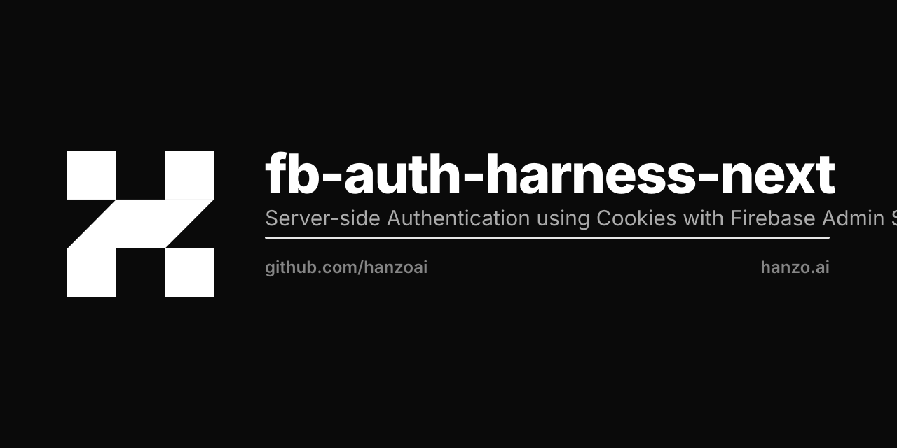

# Server-side Authentication using Cookies with Firebase Admin SDK

  

Read article at [here](https://medium.com/@bilgehan.biricik/next-js-14-server-side-authentication-using-cookies-with-firebase-admin-sdk-46542b1f0a33).
